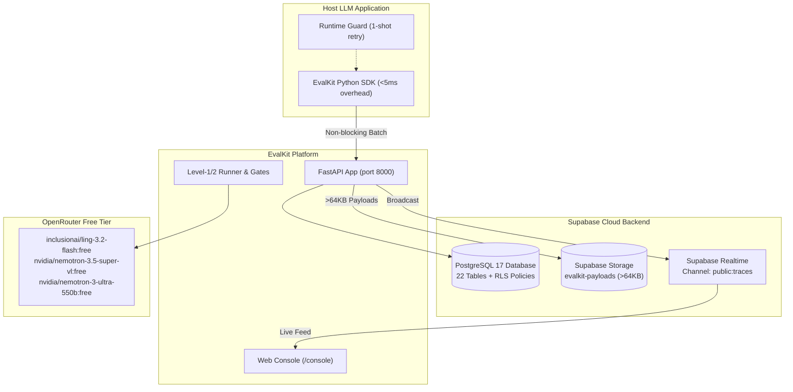

<div align="center">

# ⚡ EvalKit

### *The Standalone Evaluation Toolkit & Observability Console for LLM Applications*

[](https://www.python.org/)
[](https://supabase.com)
[](https://supabase.com)
[](https://openrouter.ai/)
[](https://pytest.org/)
[](LICENSE)

<p align="center">
  <a href="#key-features">Key Features</a> •
  <a href="#architecture">Architecture</a> •
  <a href="#quickstart">Quickstart</a> •
  <a href="#review-console">Review Console</a> •
  <a href="#sdk-usage">SDK Usage</a> •
  <a href="#cli-reference">CLI Reference</a> •
  <a href="#supabase-cloud">Supabase Cloud</a>
</p>

</div>

---

## 🎯 Overview

**EvalKit** is a full-stack, standalone evaluation system and web console designed to replace "vibe checks" with deterministic rigor. 

It provides **trace ingestion with non-blocking SDKs**, **Level-1 deterministic assertions with CI release gates**, **dataset curation**, **multi-run regression comparison**, a **frictionless keyboard-first human review console**, and an **LLM judge aligned to human critiques** reporting precision and recall.

Built with complete support for **zero-cost free resources**:
- **Cloud Backend & Database:** Supabase PostgreSQL 17 with Row-Level Security (RLS) & Storage buckets.
- **Local Fallback:** Zero-daemon SQLite (`evalkit.db`) requiring no external services.
- **LLM Models:** OpenRouter free tier (`inclusionai/ling-3.2-flash:free`, `nvidia/nemotron-3.5-super-vl:free`, `nvidia/nemotron-3-ultra-550b-a55b:free`) with automated failover on rate limits.

---

## 🚀 Key Features

| Capability | Description |
|---|---|
| **Level-1 CI Gates** | 12 built-in deterministic assertions running in CI on every commit. Catches regressions in seconds. |
| **Frictionless Review** | Single-screen keyboard review UI (<kbd>G</kbd>/<kbd>B</kbd>/<kbd>J</kbd>/<kbd>K</kbd>/<kbd>C</kbd>/<kbd>D</kbd>) with 5s undo toast and blind review mode. |
| **Aligned LLM Judge** | Single-criterion LLM judge reporting **precision and recall** (bad as positive class), confusion matrices, and disagreements. |
| **High-Throughput SDKs** | Python and TypeScript SDKs with thread-safe daemon buffering. **Under 5 ms overhead**, fail-safe on server outage. |
| **Runtime Guardrails** | In-app `guard()` with 1-shot retry feeding critique feedback back into the prompt. |
| **Synthetic Generation** | Generates challenging test cases by feature, scenario, and persona using free OpenRouter models. |
| **Run Comparison** | Per-scenario delta tables, statistical regression indicators, and side-by-side trace diffs. |
| **Payload Storage** | Offloads payloads >64 KB to Supabase Storage, keeping PostgreSQL lean and fast. |

---

## 🏗️ Architecture



---

## ⚡ Quickstart

### 1. Clone & Configure
```bash
git clone https://github.com/amano2/evalkit.git
cd evalkit
cp .env.example .env
```

Configure your environment variables in `.env`:
```env
# Database (SQLite by default, or Supabase PostgreSQL)
DATABASE_URL=sqlite:///evalkit.db

# OpenRouter Free LLM Access
OPENROUTER_API_KEY=your-openrouter-key-here
OPENROUTER_DEFAULT_MODEL=inclusionai/ling-3.2-flash:free

# Supabase (Optional for Cloud Mode)
SUPABASE_URL=https://your-project.supabase.co
SUPABASE_KEY=your-supabase-anon-key
```

### 2. Initialize Database & Seed Benchmark
```bash
make migrate
make seed
```

### 3. Run Automated Tests (18 Suites)
```bash
make test
```

### 4. Execute Level-1 200-Case Suite & CI Release Gate
```bash
make eval
```

### 5. Launch Interactive Review Console
```bash
make dev
```
Navigate to **`http://localhost:8000/console`**.

---

## 🖥️ Keyboard-First Review Console

The review console eliminates tab hopping and context switching. Everything needed to evaluate a trace is visible on a single screen:

```
+--------------------------------------------------------------------------+
| EvalKit  [Queue: Unlabelled v] [Feature v] [Scenario v]   [Connected ●]  |
+------------------------+-------------------------------------------------+
| ● tr-1042  qa/docs     | INPUT                                           |
| ◉ tr-1043  (active)    |  How is dense vector retrieval evaluated?       |
| ● tr-1044  qa/faq      | OUTPUT                                          |
| ● tr-1045  agent       |  Evaluated using recall@k and NDCG [1].         |
|                        | RETRIEVAL CONTEXT  2 chunks [expand]            |
|                        | ASSERTIONS  [✓] has_citation  [✓] no_pii        |
|                        | JUDGE VERDICT  GOOD - "Grounded in context"      |
|                        |-------------------------------------------------|
|                        | [Good (G)]  [Bad (B)]  Critique: ______________ |
|                        | [Add to dataset (D)]   [Undo Toast] [Next: ↓/J] |
+------------------------+-------------------------------------------------+
```

### Keyboard Shortcuts Reference

| Key | Action | Description |
|:---:|:---|:---|
| <kbd>G</kbd> | **Mark Good** | Saves a binary `good` label and auto-advances to the next trace. |
| <kbd>B</kbd> | **Mark Bad** | Saves a binary `bad` label and auto-advances to the next trace. |
| <kbd>J</kbd> / <kbd>↓</kbd> | **Next Trace** | Navigates down the active queue. |
| <kbd>K</kbd> / <kbd>↑</kbd> | **Previous Trace** | Navigates up the active queue. |
| <kbd>C</kbd> | **Focus Critique** | Focuses the one-line critique input field. |
| <kbd>D</kbd> | **Add to Dataset** | Converts current trace into a regression test case. |
| <kbd>Ctrl</kbd> + <kbd>Z</kbd> | **Undo Label** | Restores the previous trace with a 5-second undo toast. |

---

## 📦 Python SDK Usage

Instrument any Python LLM application in just a few lines:

```python
from sdk.python.evalkit import trace, span, guard

# 1. Non-blocking trace context
with trace(feature="qa", scenario="answer_in_docs") as t:
    
    # 2. Instrument retrieval
    with span("dense_retrieval", kind="retrieval") as s:
        chunks = ["Passage text excerpt [1]"]
        s.set_output({"chunks": chunks})

    # 3. Instrument model generation
    with span("llm_generate", kind="model", attributes={"model": "gpt-4o"}) as s:
        response = "According to the documentation, passage excerpt [1]."
        s.set_output(response)

    # 4. Runtime guard with feedback retry
    verified_answer = guard("has_citation", response)
    t.set_output(verified_answer)
```

- **Zero-Block Daemon Worker:** Batches are sent asynchronously via a background daemon thread.
- **Fail-Safe Guarantee:** If the EvalKit server is down or unreachable, spans are dropped safely and counted. Host applications never raise exceptions or experience latency spikes.
- **Under 5 ms Overhead:** Verified under high-throughput benchmarks.

---

## 🛠️ CLI Reference

EvalKit includes a CLI for local workflows and CI/CD pipelines:

```bash
# Run Level-1 evaluation on a dataset
python backend/cli.py run --dataset sample_golden_suite --level 1 --executor fake

# Check release gates (Exit code 0 = pass, 1 = gate failed, 2 = error)
python backend/cli.py gate --run-id latest

# Inspect LLM judge alignment metrics (precision, recall, confusion matrix)
python backend/cli.py align --judge-id faithfulness_judge

# Generate synthetic cases using OpenRouter free models
python backend/cli.py generate --dataset sample_golden_suite --feature qa --scenario answer_in_docs --count 10

# Export curated fine-tuning dataset to JSONL
python backend/cli.py export --output ./exports/finetune.jsonl
```

---

## ☁️ Supabase Cloud Architecture

EvalKit seamlessly scales from local SQLite to Supabase Cloud:
- **PostgreSQL 17 Database:** 22 relational tables with composite index optimizations.
- **Row-Level Security (RLS):** All 22 tables have RLS enabled with permissive service policies.
- **Supabase Storage:** Automatic payload threshold inspector offloads payloads >64 KB to bucket `evalkit-payloads`.
- **Supabase Realtime:** Built-in WebSocket channel listener updates the console in real time as traces arrive.

---

## 🧪 Built-in Assertions (Level 1)

EvalKit includes 12 built-in deterministic assertion checks:
1. `has_citation`: Validates numerical citation markers (`[1]`).
2. `citations_in_supplied_set`: Confirms citations match retrieved context indices.
3. `not_found_when_unsupported`: Ensures the model declines to answer when context is empty rather than hallucinating.
4. `no_internal_ids_leaked`: Scans for UUIDs, database keys, or object identifiers.
5. `no_system_prompt_leak`: Guards against system prompt leakage.
6. `valid_json_schema`: Validates outputs against strict JSON Schemas.
7. `tool_args_match_schema`: Verifies tool call arguments match parameter specifications.
8. `contains` / `not_contains`: Substring validation checks.
9. `regex`: Regular expression pattern matching.
10. `latency_under_budget`: Flags latency SLA breaches.
11. `cost_under_budget`: Asserts token costs remain within dollar budget limits.
12. `no_pii`: Validates output is free of unredacted emails, SSNs, and credit cards.

---

## 📄 License

MIT License. Built for autonomous, scalable LLM evaluation.
